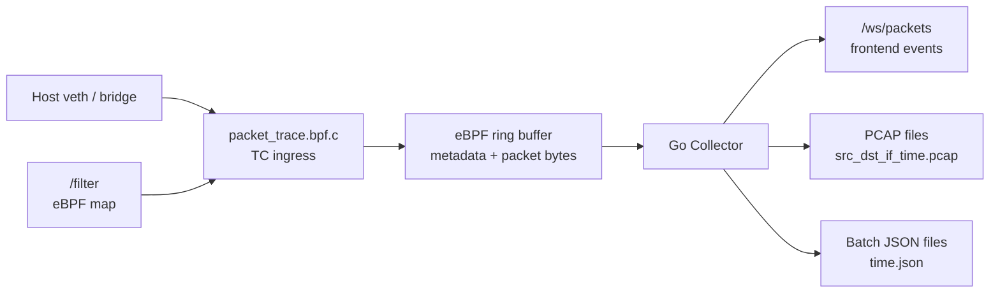
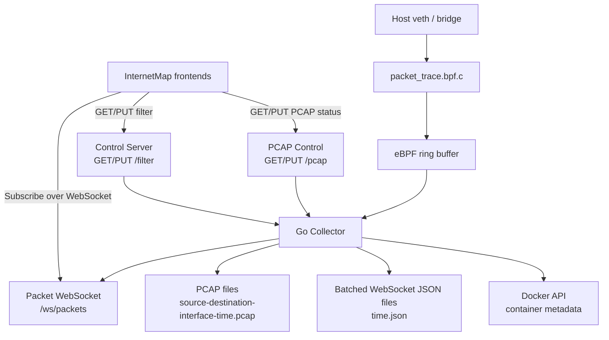

# traffic-observer-service

`traffic-observer-service` is the renamed successor to `traffic-observer`. It uses eBPF to capture packet metadata from container virtual interfaces. When enabled, it can also save raw packets to PCAP files and batch the packet events sent over WebSocket into JSON files.

## Responsibilities

- Compile and load the eBPF program.
- Attach the program to host-side container interfaces, such as veth devices and bridges.
- Receive packet metadata through an eBPF ring buffer.
- Provide `/filter` to control packet capture.
- Provide `/pcap` to enable or disable file recording and query its status.
- Provide `/ws/packets` for clients to subscribe to live packet events.
- Optionally save captured raw Ethernet frames to PCAP files.
- Optionally save the packet events sent to clients as batched JSON files.

## Data flow



## eBPF event contents

When a packet matches the filter, the eBPF program submits the following information to the ring buffer:

- Packet metadata:
  - Timestamp
  - Host interface index
  - Packet length
  - Direction
  - Ethernet protocol
  - Source and destination MAC addresses
  - IPv4 source and destination addresses
  - IP protocol
  - TCP / UDP source and destination ports
  - TCP flags
  - TTL
  - Total IP length
- Packet bytes:
  - Captured from byte offset `0` of the Ethernet frame
  - Maximum captured length: `32768` bytes
  - The PCAP record's `origLen` retains the original packet length

## Call relationships



## Filter API

`/filter` controls the capture expression stored in the eBPF map. An empty string disables capture; `all` captures every packet.

Get the current filter:

```bash
curl http://127.0.0.1:19092/filter
```

Set a filter:

```bash
curl -X PUT http://127.0.0.1:19092/filter \
  -H "Content-Type: application/json" \
  -d '{"filter":"icmp"}'
```

Stop capture:

```bash
curl -X PUT http://127.0.0.1:19092/filter \
  -H "Content-Type: application/json" \
  -d '{"filter":""}'
```

When a non-empty filter is submitted, the service checks whether the number of attached interfaces meets `TRAFFIC_EXPECTED_INTERFACE_COUNT`. If it is below the configured count, the service rediscovers interfaces through Docker and reattaches the eBPF program. If the refreshed count is still below the threshold, the request returns `503 Service Unavailable` and the filter is not applied. An empty filter does not trigger interface discovery.

## PCAP / JSON recording API

`/pcap` controls file recording. This switch does not change the eBPF filter; it only controls whether packets already matched by the filter are written to files.

Get recording status:

```bash
curl http://127.0.0.1:19092/pcap
```

Example response:

```json
{
  "enabled": true,
  "outputDir": "/data/pcap",
  "currentPcapFile": "/data/pcap/10.150.0.72_10.151.0.72_veth123abc_20260811143022.pcap",
  "currentJsonFile": "/data/pcap/20260811143020.json",
  "packetCount": 10,
  "byteCount": 980,
  "messageCount": 10
}
```

Enable recording:

```bash
curl -X PUT http://127.0.0.1:19092/pcap \
  -H "Content-Type: application/json" \
  -d '{"enabled":true}'
```

Disable recording:

```bash
curl -X PUT http://127.0.0.1:19092/pcap \
  -H "Content-Type: application/json" \
  -d '{"enabled":false}'
```

### File output

Enabling recording produces two kinds of files.

1. PCAP files

   Filename format:

   ```text
   sourceIP_destinationIP_interface_YYYYMMDDhhmmss.pcap
   ```

   Example:

   ```text
   10.150.0.72_10.151.0.72_veth123abc_20260811143022.pcap
   ```

   Notes:
   - The PCAP file contains the raw Ethernet frame bytes captured by eBPF.
   - A PCAP file is created when the first packet arrives during a recording session.
   - Each recording session maintains one PCAP file. Its name uses the source IP, destination IP, interface, and timestamp of the first packet in that session.

2. Batched JSON files

   Filename format:

   ```text
   YYYYMMDDhhmmss.json
   ```

   Example:

   ```text
   20260811143020.json
   ```

   Notes:
   - JSON contains the same `PacketMessage` events sent to clients through `/ws/packets`.
   - A recording session begins when recording is enabled and ends when it is disabled.
   - Enabling recording again creates a new JSON file.
   - Each file contains a JSON array.

## Log time zone

Go's standard `log` package uses the process's local time. Containers commonly default to UTC, which may make log timestamps eight hours behind Beijing time.

Set the time zone at startup with:

```bash
TRAFFIC_LOG_TIMEZONE=Asia/Shanghai
```

The default is `Asia/Shanghai`. If the time zone cannot be loaded, the service falls back to a fixed UTC+8 time zone.

## Docker

- Directory: `traffic-observer-service/`
- Container name: `traffic-observer-service`
- Default control / WebSocket address: `:19092`
- Runtime settings: `privileged: true`, `pid: host`, and `network_mode: host`
- Because the service uses host networking, the Go server listening on `:19092` is exposed directly on host port `19092`. Do not add a Compose `ports` mapping.
- Default PCAP / JSON output directory: `/data/pcap`
- PCAP / JSON output is stored only in the container filesystem; it is not persisted to a host directory. Files may be lost when the container is removed or recreated.

Common environment variables:

| Variable | Default | Description |
| --- | --- | --- |
| `TRAFFIC_FILTER` | Empty string | Initial eBPF filter; empty disables capture. |
| `TRAFFIC_CONTROL_ADDR` | `:19092` | Address used by the control API and packet WebSocket. |
| `TRAFFIC_PCAP_ENABLED` | `false` | Whether file recording starts enabled. |
| `TRAFFIC_PCAP_OUTPUT_DIR` | `/data/pcap` | Directory for PCAP / JSON output. |
| `TRAFFIC_LOG_TIMEZONE` | `Asia/Shanghai` | Time zone used by Go standard logs. |
| `TRAFFIC_ONLY_SEED_CONTAINERS` | `true` | Whether discovery is limited to SEED container veth interfaces. |
| `TRAFFIC_DISCOVERY_CONCURRENCY` | `32` | Maximum concurrency for container interface discovery. |
| `TRAFFIC_EXPECTED_INTERFACE_COUNT` | `1` | Expected number of emulator container interfaces. Before applying a non-empty filter, discovery is retried if fewer interfaces are attached; if the refreshed count is still below the threshold, the request returns 503 without applying the filter. |

## Test coverage

See [traffic-observer-service test coverage](./test/traffic-observer-service-testing.md) for the Mermaid test coverage diagrams.
