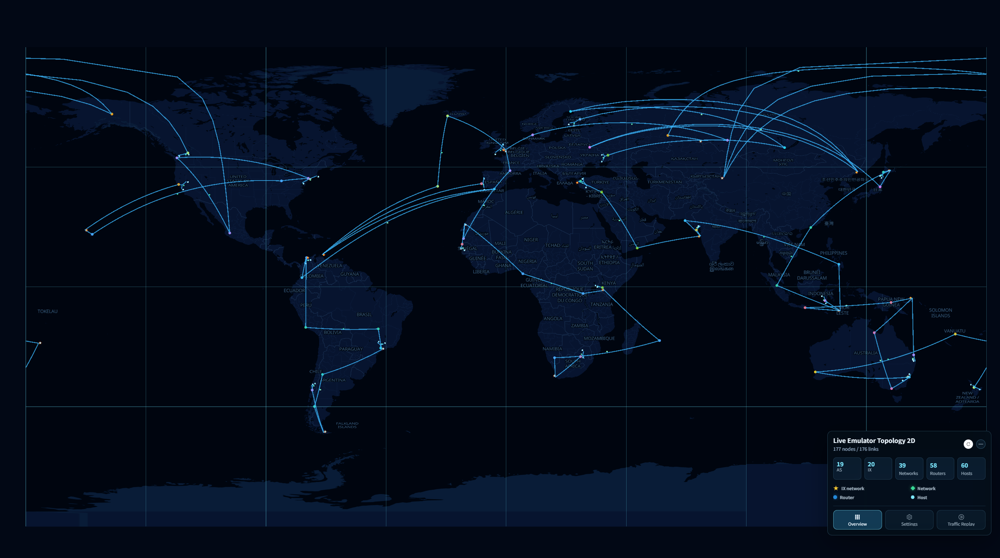

[User manual](../user-manual.md)

# InternetMap-Geographic 2D

Geographic 2D has the same features as Geographic 3D. The only difference is the view: 2D uses a flat world map, while 3D uses a globe. Emulator setup, topology upload, filtering, search, node actions, and traffic replay follow the [Geographic 3D guide](../geographic-3d/README.md).

*Background imagery was unavailable when this screenshot was captured.*

## Open the view

Open Geographic Home at `http://<ip>:<port>`. Both 2D and 3D use the same Geographic service and port. From Home, choose:

- **LIVE EMULATOR TOPOLOGY 2D** for a running experiment.
- **EMULATOR TOPOLOGY 2D** to upload a saved topology.

## First walkthrough

1. Open the live or upload 2D view from Home and wait for the topology to load.
2. Drag the map to pan and use the mouse wheel to zoom. Connections crossing the map boundary may continue on an adjacent map copy.
3. Follow the [Geographic 3D walkthrough](../geographic-3d/README.md#first-walkthrough) for the shared controls, including **Overview**, **Settings**, node details, and [Traffic Replay](../geographic-3d/traffic-replay.md). Keep using the 2D page when the guide refers to a 3D page; pan the map when it describes rotating the globe.
