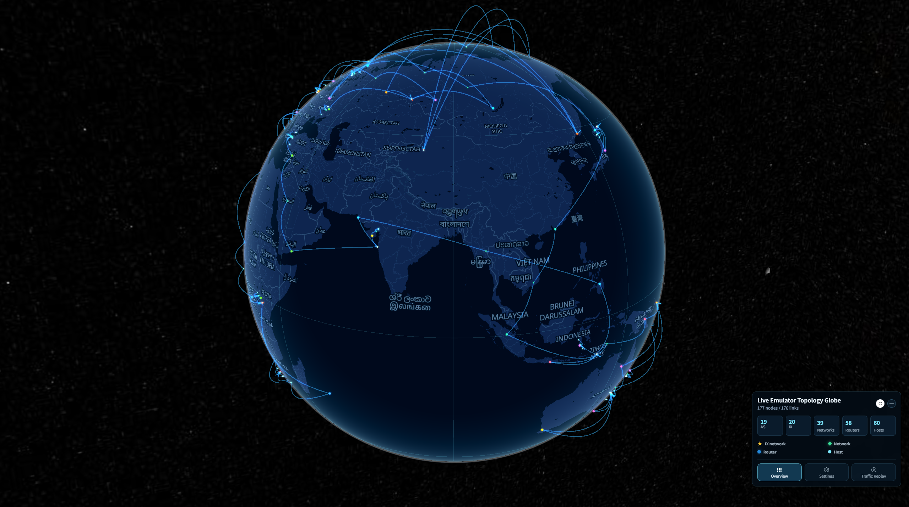

[User manual](../user-manual.md)

# InternetMap-Geographic 3D

The 3D view places the experiment on a globe. Use it to explore the geographic distribution of hosts, routers, and exchanges, and to follow connections between distant locations. Nodes on the far side of the globe may be hidden until you rotate it.



*The example has no background imagery because the imagery service was unavailable during capture.*

## Use with the emulator

Add the following code to your emulator script before compiling the experiment. This example assumes that **emu** is your configured emulator, **platform** is your selected Docker platform, and **Docker** and **InternetMap** are already imported from your installed SEED Emulator version. Your version must support the InternetMap container bundle.

```python
docker = Docker(platform=platform)

# Add Internet visualization services: topology, geographic map, and traffic observation.
# The second argument is a container name suffix that distinguishes bundle instances.
internet_map_bundle = InternetMap(emu, ".map.seed")
# Customize the bundle network; provide at least one IP per container, in creation order.
# All IPs must belong to the configured subnet, which should not overlap other networks.
internet_map_bundle.setDefaultNetwork(
    name="internetMap_network",
    prefix=".map",
    ip_addresses=[
        "172.30.0.10",
        "172.30.0.11",
        "172.30.0.12",
        "172.30.0.13",
    ],
    network_config={
        "driver": "bridge",
        "ipam": {"config": [{"subnet": "172.30.0.0/24", "gateway": "172.30.0.1"}]},
    },
)
# Provide a host port pool (range excludes the stop value); InternetMap needs at least 3 ports.
internet_map_bundle.setPorts(list(range(8081, 8089)))
# Register the bundle with the Docker compiler to generate its containers during emu.compile().
docker.addContainerBundle(internet_map_bundle)
```

Continue with your script's rendering and compilation steps, passing this **docker** compiler to **emu.compile()**. Register the bundle once per experiment; the same bundle provides both Geographic views and the Topology website.

The example network must not overlap the experiment's other networks. The port pool contains ports **8081 through 8088**; it is not a fixed assignment of a particular port to a particular service.

### Find the service ports

After running the emulator script, read the service port mappings printed in the terminal. For example:

```text
service seedemu_internet_map_toplogy: port mapping ['8087:80']
service seedemu_internet_map_geographic: port mapping ['8086:80']
service seedemu_traffic_observer_service: port mapping [8088]
```

You can also open the generated **docker-compose.yml** and find the **ports** entry under the relevant service. The following excerpt shows the same example mappings:

```yaml
services:
  seedemu_internet_map_toplogy:
    ports:
      - "8087:80"

  seedemu_internet_map_geographic:
    ports:
      - "8086:80"
```

For a mapping such as **8086:80**, the number on the left is the host port used in your browser; the number on the right is the port inside the container. Use the actual mapping from your generated output, as assignments can differ between experiments.

## Open the view

Open Geographic Home at `http://<ip>:<port>` on your Geographic website. From the home page, choose:

- **LIVE EMULATOR TOPOLOGY 3D** to view a live experiment.
- **EMULATOR TOPOLOGY 3D** to upload and explore a saved topology.

## First walkthrough

1. [Open the live topology](live-topology.md) or [upload a saved topology](upload-topology.md), then wait for the node and link counts to appear.
2. Drag the globe to rotate it and use the mouse wheel to zoom.
3. Read the node-type legend in **Overview** and use [Overview and topology filters](overview-filters.md) to focus on selected AS or IX groups.
4. Open **Settings**, enter a node name or address, and click **Search**. See [Search and display settings](search-display.md) for search and visibility controls.
5. Enable **Hover details** and point to a node to inspect it. See [Node details and runtime actions](node-actions.md) for available information and live controls.
6. Open **Traffic Replay** to observe live packets or review a saved capture. Follow [Capture and replay traffic](traffic-replay.md) for the workflow matching your page.

The panel at the bottom right has **Overview**, **Settings**, and **Traffic Replay** tabs. Its minimize button creates more room for the map; click the collapsed panel to reopen it.

## Common questions

| Problem | What to try |
| --- | --- |
| No nodes appear | On a live page, refresh and ask whether the experiment is running. On an upload page, select a file and click Parse file. |
| A node seems to be missing | Clear AS / IX filters and enable its node type in Settings. Rotate the globe or search for the node. |
| Links disappear | Enable Network in Settings and turn off Packet path links only when you want the complete topology. |
| The background map is missing | If nodes are visible, you can still inspect them. Ask the administrator to check the imagery service. |
| Traffic controls are unavailable | Check whether you are on a live or upload page and follow the traffic guide for that workflow. |

For a flat overview, see [Geographic 2D](../geographic-2d/README.md).
