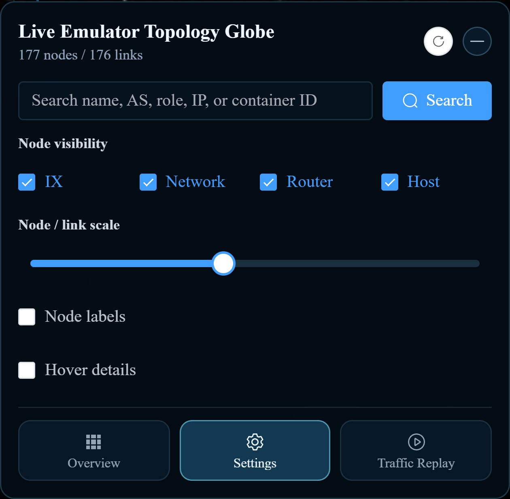

[User manual](../user-manual.md) / [Geographic 3D](README.md)

# Node details and actions in 3D

Use node details to identify an endpoint before acting on it. Static details work on live and uploaded pages; runtime actions are available only for running nodes on **/pro/map/3d**.

*This image shows the setting used to open node details, rather than the details card itself.*

## Inspect a node

1. Open **Settings** and enable **Hover details**.
2. Search for the node if necessary.
3. Hover over it and read its name, role, AS number, and IP addresses.
4. On a live page, inspect the **Actions** section and, for supported routing nodes, **BGP sessions**.

## Use runtime actions

| Task | Procedure | Expected result |
| --- | --- | --- |
| Open a terminal | Use the console action in Actions. | A terminal window opens inside the page for that container. |
| Disconnect a node | Verify its identity, then use Disconnect. | The running node's network connectivity changes. |
| Restore connectivity | Use the re-connect action. | The node is reconnected. |
| Update runtime details | Use the runtime refresh action. | The card reloads the node's current information. |
| Change a BGP peer | Find the peer in BGP sessions and choose Disable or Enable. | The selected peer's state is changed; refresh to inspect the result. |

Connection and BGP changes affect the running experiment and can interrupt traffic. Use them as part of your lab procedure and restore the previous state when that procedure requires it.

## When an action is missing

Uploaded nodes have static information only. A host does not have router BGP controls, and a routing node may have no configured peers. Console availability also depends on the lab configuration. Ask your administrator if an expected live action is unavailable; selecting another display mode does not grant additional access.

[Back to Geographic 3D](README.md)
