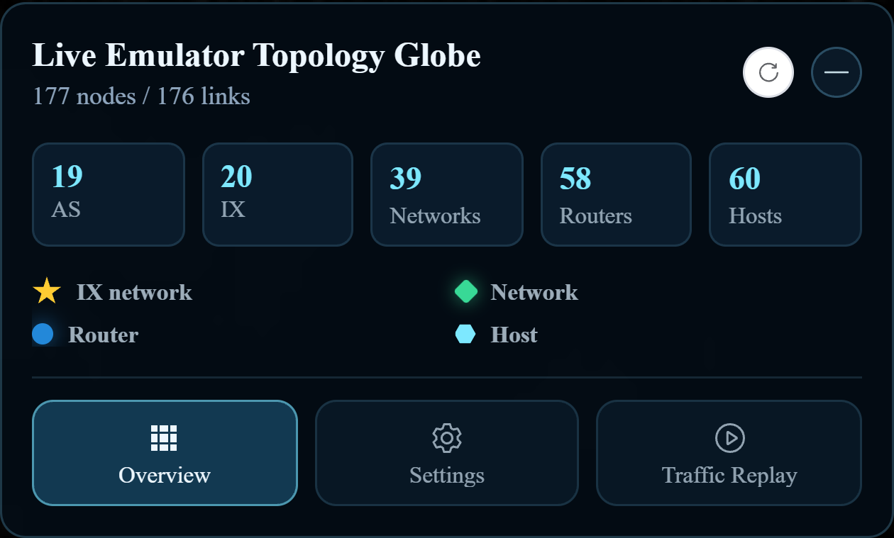

[User manual](../user-manual.md) / [Geographic 3D](README.md)

# Overview and filters in 3D

Use **Overview** to understand the visible topology and focus on the groups relevant to your task. These controls are available on both live and uploaded topology pages.

## Read the counts

The header reports rendered nodes and links. The cards summarize AS, IX, Networks, Routers, and Hosts. The legend below explains how node types are drawn. Counts depend on the loaded experiment and the applied display filters.

## Focus on an autonomous system

1. Click **Overview**, then the **AS** count card.
2. Open **Select AS** and search for or select one or more AS values.
3. If needed, enable the details option to inspect the listed routers.
4. Click **Apply AS filter**.
5. Inspect the related nodes and connections in the globe view.

## Focus on an exchange

1. Click the **IX** count card.
2. Select the exchanges you want to inspect.
3. Click **Apply IX filter**.
4. Use **Clear topology filters** to return to the unfiltered topology.

Selecting an AS or IX changes what the map displays; it does not stop other nodes or change routing. If a node remains hidden after clearing filters, check its visibility in [Settings](search-display.md).

Use topology filters to choose **which nodes** to show. Use a [capture filter](traffic-replay.md) to choose **which packets** to observe.

[Back to Geographic 3D](README.md)
