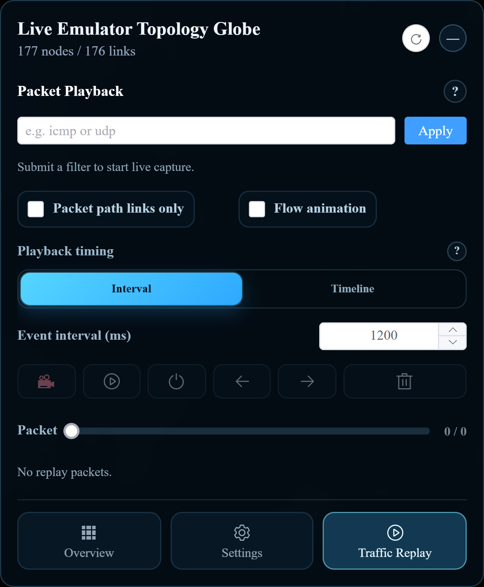

[User manual](../user-manual.md) / [Geographic 3D](README.md)

# Capture and replay traffic in 3D

Use **Traffic Replay** to observe packet activity and review captured events. Start with the workflow matching your page: live **/pro/map/3d** or uploaded **/pro/upload/3d**.

## Live packets

Before starting, the experiment must be running and traffic capture must be available in your lab.

1. Open the live topology and choose **Traffic Replay**.
2. Enter a capture expression, such as **icmp**, and click **Apply**.
3. Observe matching traffic. There must be actual matching packets in the experiment; applying a filter does not generate traffic.
4. Enable the recording control (record icon) if you want incoming events saved in the page's replay list.
5. When enough events have arrived, turn recording off.
6. To stop live capture, clear the filter field and click **Apply** again.
7. Use the playback controls to review the recorded events.

Capturing and recording are separate: the Packet total grows only for events received while recording is enabled. The live recording limit is 100,000 packets; reaching it stops recording and returns the Packet position to the start. Treat the recording as temporary page data and avoid refreshing the browser while reviewing it.

## Offline packets

First [upload the saved topology](upload-topology.md), then open **Traffic Replay** and click **Import capture file**.

| Files selected | Available workflow |
| --- | --- |
| Collector JSON | Import and replay its packet events; the packet filter is disabled. |
| Collector JSON plus matching PCAP | Import the events and apply a packet filter to the PCAP before replay. |

Use files from the same capture: PCAP packet number N must correspond to JSON record number N. Select the files together in the file picker, wait for import to finish, and check the Packet total. If you imported JSON and PCAP together, enter a filter such as **icmp** and click **Apply** to restrict playback to matching packets. Then start playback. A PCAP alone is not a substitute for collector JSON. Offline filtering affects the uploaded capture and does not start live capture.

## Playback controls

| Control | Use |
| --- | --- |
| Play / pause | Start playback or pause at the current position. |
| Stop | Stop playback. |
| Left / right step | Move backward or forward by one packet. |
| Packet slider | Move to a position in the recorded or imported events. |
| Clear | Remove the loaded replay events. |
| Interval | Use a fixed Event interval in milliseconds between packets. |
| Timeline | Follow packet timestamps at the selected Timeline speed. |
| Time window | In Timeline mode, group nearby timestamps into windows; zero disables windowing. |
| Flow animation | Show inferred packet paths when they can be resolved. |
| Packet path links only | Limit displayed connections to packet paths. |

For example, an Interval of **1200 ms** plays one event every 1.2 seconds. A Timeline speed of **2** halves the timestamp-based delays. In live recordings, a positive Time window groups packets in a window together, so the Packet position may advance by several packets at once.

## If playback looks different from expected

| Symptom | What to check |
| --- | --- |
| Packet total stays at zero | Enable recording for live traffic; for offline traffic, check that import completed. |
| No live activity | Confirm that the filter matches traffic and ask the experiment operator whether capture is available. |
| Offline filter is disabled | Import both JSON and its matching PCAP. |
| No visible paths | The topology must match the capture. Try node highlights; a packet does not always provide enough information to infer a path. |
| A calculation message appears | Wait for path analysis to finish before using playback controls again. |
| Links disappear | Turn off Packet path links only to restore the broader view. |

If live path analysis repeatedly fails, the page can disable Flow animation and continue with node highlights. This does not mean that all capture has stopped.

[Back to Geographic 3D](README.md)
