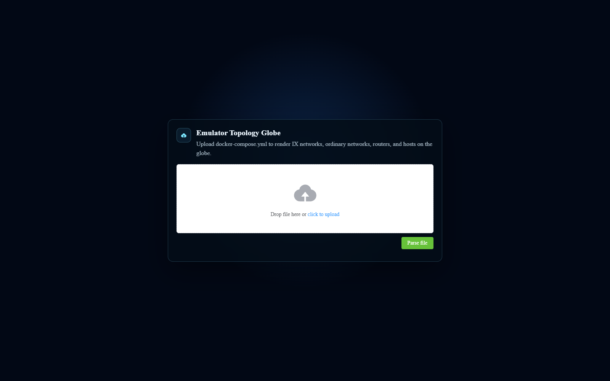

[User manual](../user-manual.md) / [Geographic 3D](README.md)

# Upload a topology in 3D

Use this workflow to inspect a saved experiment without running its nodes. Obtain the emulator-generated **docker-compose.yml** from the experiment owner; an unrelated Compose file may not contain the metadata needed to draw a topology.

## Open the file

1. From Geographic Home, choose **EMULATOR TOPOLOGY 3D** (route **/pro/upload/3d**).
2. Drag the Compose file onto the drop zone, or click the upload link and select it.
3. Click **Parse file**.
4. Wait for the topology and node counts to appear.
5. Rotate and zoom the globe, then use Overview and Settings to inspect the result.

## What you can do next

You can search, select AS / IX groups, change node visibility, and inspect static node details. The refresh button redraws the loaded topology. It does not retrieve a running experiment.

To examine a saved capture, follow the **Offline packets** section of [Capture and replay traffic](traffic-replay.md). Load the topology associated with that capture so packet addresses can be matched to its nodes.

## Limits and recovery

Uploading a file does not start containers. Live capture, console access, connection changes, and BGP actions are unavailable in this workflow. To use those actions, open the live page for the running experiment.

If parsing fails or the map stays empty, check that you selected the complete emulator output file. Ask the experiment owner for a valid export rather than editing unknown fields. For a large topology, wait for loading to finish before changing filters.

[Back to Geographic 3D](README.md)
