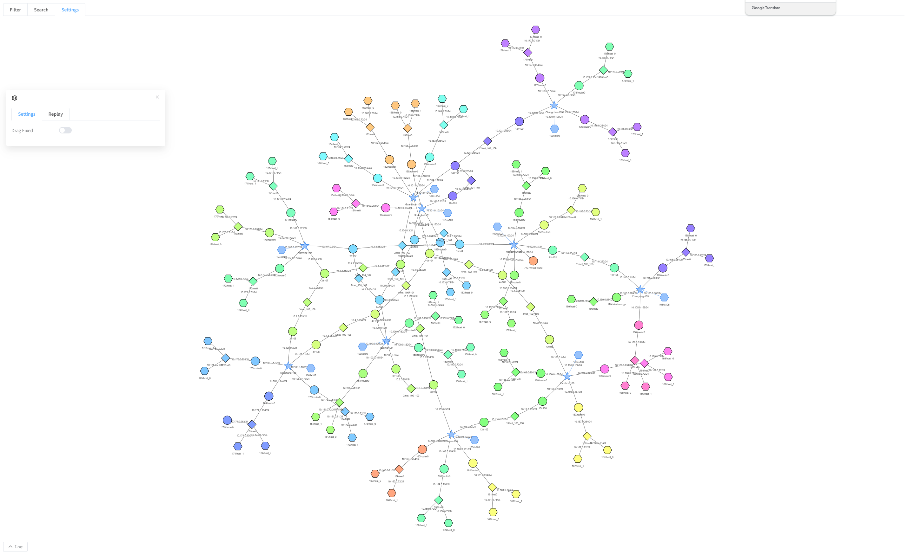

[User manual](../user-manual.md)

# InternetMap-Toplogy

Topology draws your experiment as a network diagram. Use it to understand how nodes connect, examine Internet exchanges and transit networks, find endpoints, and observe traffic. Diagram positions represent a layout of connectivity rather than geographic locations.



## Use with the emulator

Add the following code to your emulator script before compiling the experiment. This example assumes that **emu** is your configured emulator, **platform** is your selected Docker platform, and **Docker** and **InternetMap** are already imported from your installed SEED Emulator version. Your version must support the InternetMap container bundle.

```python
docker = Docker(platform=platform)

# Add Internet visualization services: topology, geographic map, and traffic observation.
# The second argument is a container name suffix that distinguishes bundle instances.
internet_map_bundle = InternetMap(emu, ".map.seed")
# Customize the bundle network; provide at least one IP per container, in creation order.
# All IPs must belong to the configured subnet, which should not overlap other networks.
internet_map_bundle.setDefaultNetwork(
    name="internetMap_network",
    prefix=".map",
    ip_addresses=[
        "172.30.0.10",
        "172.30.0.11",
        "172.30.0.12",
        "172.30.0.13",
    ],
    network_config={
        "driver": "bridge",
        "ipam": {"config": [{"subnet": "172.30.0.0/24", "gateway": "172.30.0.1"}]},
    },
)
# Provide a host port pool (range excludes the stop value); InternetMap needs at least 3 ports.
internet_map_bundle.setPorts(list(range(8081, 8089)))
# Register the bundle with the Docker compiler to generate its containers during emu.compile().
docker.addContainerBundle(internet_map_bundle)
```

Continue with your script's rendering and compilation steps, passing this **docker** compiler to **emu.compile()**. Register the bundle once per experiment; the same bundle provides both Geographic views and the Topology website.

The example network must not overlap the experiment's other networks. The port pool contains ports **8081 through 8088**; it is not a fixed assignment of a particular port to a particular service.

### Find the service ports

After running the emulator script, read the service port mappings printed in the terminal. For example:

```text
service seedemu_internet_map_toplogy: port mapping ['8087:80']
service seedemu_internet_map_geographic: port mapping ['8086:80']
service seedemu_traffic_observer_service: port mapping [8088]
```

You can also open the generated **docker-compose.yml** and find the **ports** entry under the relevant service. The following excerpt shows the same example mappings:

```yaml
services:
  seedemu_internet_map_toplogy:
    ports:
      - "8087:80"

  seedemu_internet_map_geographic:
    ports:
      - "8086:80"
```

For a mapping such as **8086:80**, the number on the left is the host port used in your browser; the number on the right is the port inside the container. Use the actual mapping from your generated output, as assignments can differ between experiments.

## Open the view

Open Topology Home at `http://<ip>:<port>` on your Topology website. From the home page, choose:

- **MAP** to view a live experiment.
- **Upload MAP** to upload and explore a saved topology.

## First walkthrough

1. Once the experiment is running, open **MAP** to [explore the network map](network-map.md). For offline work, choose **Upload MAP** to [upload a saved topology](upload-topology.md); runtime actions are unavailable for uploaded nodes.
2. Wait for the diagram to load, then drag empty canvas space to pan and scroll to zoom. The [network map guide](network-map.md) also explains how to expand or collapse nodes.
3. Open **Search**, enter a node name or IP address, and submit it. Use [Search and display settings](search-display.md) to find matches and adjust the layout.
4. Click a matching node to inspect its details. For live nodes, see [Node actions and terminals](node-actions.md) for console access and connection controls.
5. To focus on exchanges or transit networks, return to Home and choose **IX MAP** or **TRANSIT MAP**. Follow the [IX view](ix-view.md) or [Transit view](transit-view.md) guide to select the groups to display.
6. On a live map, open **Filter** to observe packets, **Replay** to review recorded activity, and **Log** to inspect packet records. See [Capture, replay, and packet log](traffic-replay.md).
7. To inspect node and network tables, open **DASHBOARD** from Home and follow the [Dashboard guide](dashboard.md).
8. If your experiment requires additional visualization tools, open **PLUGIN** from Home and follow the [Plugins guide](plugins.md).

## Common questions

| Problem | What to try |
| --- | --- |
| The map is empty | Wait for the experiment to finish starting. On IX / Transit pages, check the initial display prompt and your selected groups. |
| A host is missing | Use MAP or expand an appropriate node; IX and Transit views initially show less detail. |
| A search finds nothing | Use a name or address from the loaded experiment and check which groups are displayed. |
| No packets appear | Check the capture filter, real traffic, and the availability of capture in your lab. |
| Console or runtime actions are absent | Uploaded topologies have no runtime controls; live controls also depend on the lab configuration. |
| A Dashboard toolbar button does nothing | Several actions in that page are placeholders; see the Dashboard guide for supported tasks. |

For spatial views, use [Geographic 2D](../geographic-2d/README.md) or [Geographic 3D](../geographic-3d/README.md).
