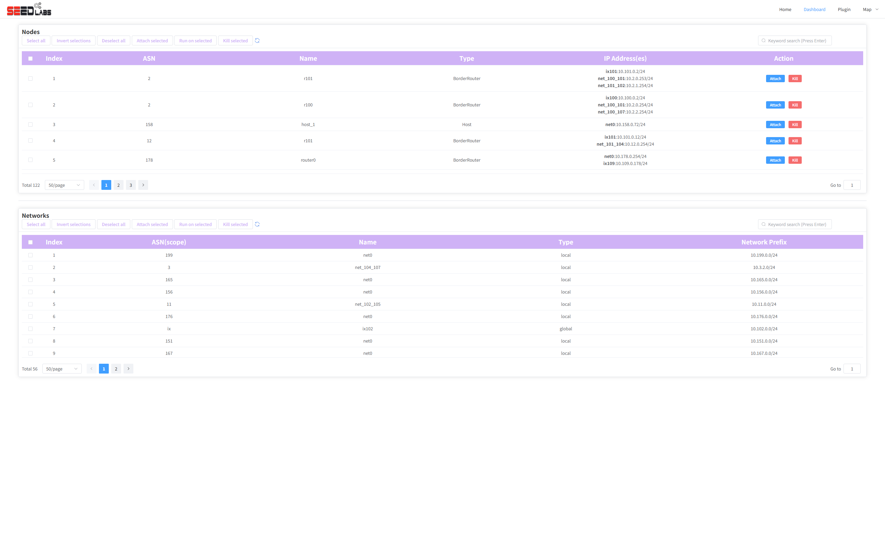

[User manual](../user-manual.md) / [Topology](README.md)

# Inspect the Dashboard

Choose **DASHBOARD** on Home to open **/pro/dashboard**. Use it to read the running experiment's nodes and networks as tables, especially when a diagram is too crowded to compare addresses.

## Read node information

1. Locate the **Nodes** table.
2. Compare each row's **ASN**, **Name**, **Type**, and **IP Address(es)**.
3. Use the table's page controls or page-size selector to see more rows.
4. Use the refresh control to reload current information when the experiment changes.

## Read network information

Find the **Networks** table and inspect the network name, scope, type, and prefix. Its pagination is separate from the Nodes table. A network prefix describes the address range; a node may have addresses on several networks.

## Current interface limitations

In the current implementation, the Dashboard's keyword-search action, selection / bulk-action toolbar, and row **Attach** / **Kill** actions are placeholders. They may appear on screen without performing the advertised action. Use this page for inspection and pagination.

To search for a node, use the [map Search tab](search-display.md). To open a terminal or control a live node, use [the map's node details](node-actions.md).

If the tables are empty or show a loading error, refresh once and ask whether the experiment is available. An uploaded topology does not populate this live Dashboard.

[Back to Topology](README.md)
