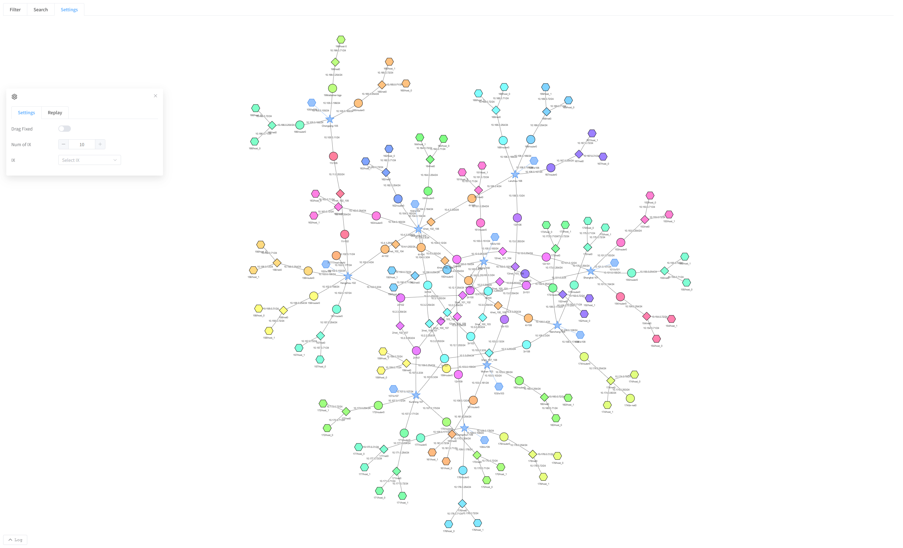
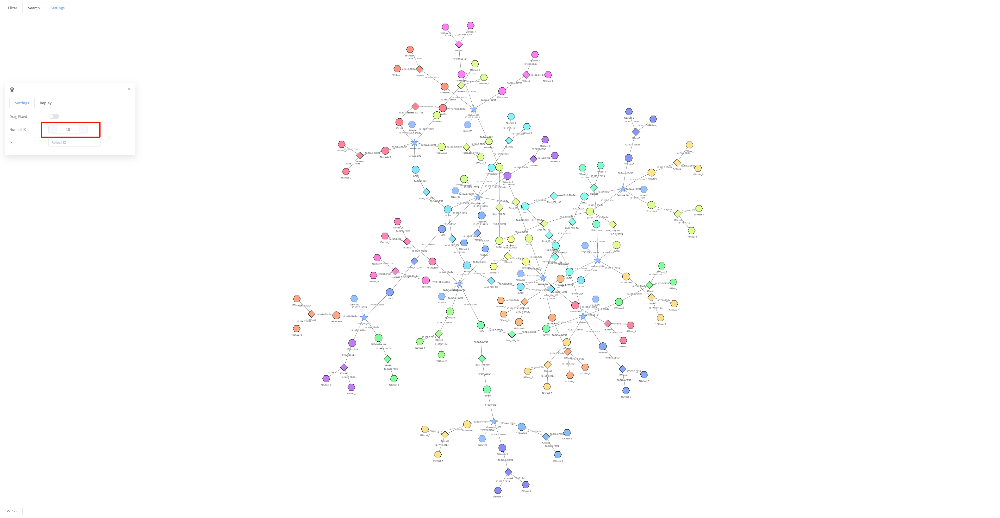
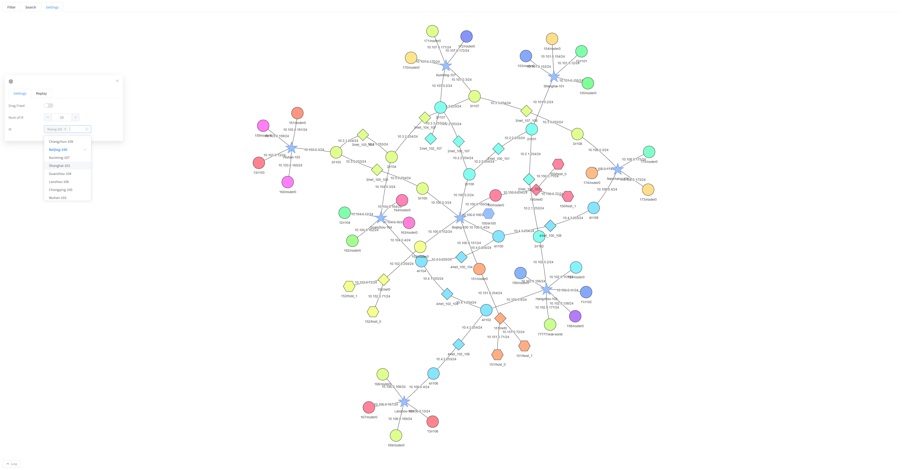

[User manual](../user-manual.md) / [Topology](README.md)

# Explore the IX view

Choose **IX MAP** on Home to open **/pro/ixMap**. This view starts at the Internet exchange level, with deeper host detail omitted initially. IX nodes are represented by stars in the example diagram.

## Choose the initial scope

If the page asks whether to display all nodes, choose **Yes** for the full initial view. Choose **No** to begin by selecting the groups in **Settings ? Categories**.

## Limit the number of exchanges

1. Open **Settings**.
2. Change **Num of IX**.
3. Click outside the number field to apply it.
4. Wait for the diagram to redraw.

The selection uses exchange connectivity weight, so a numeric limit is not a request for specific exchange IDs.

## Choose exchanges by name

1. Open the **IX** selector in Settings.
2. Select the exchanges you want to inspect.
3. Click outside the selector to apply the selection.
4. To broaden the view again, restore the exchanges you want included and increase the count if needed.

The resulting diagram focuses on those exchanges. Selecting an exchange changes the view only. For individual host inspection, expand the appropriate nodes or switch to [MAP](network-map.md). Search, settings, and live traffic controls follow the shared map workflows.

[Back to Topology](README.md)
