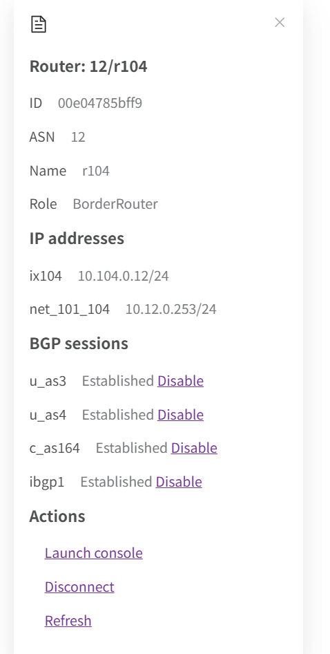
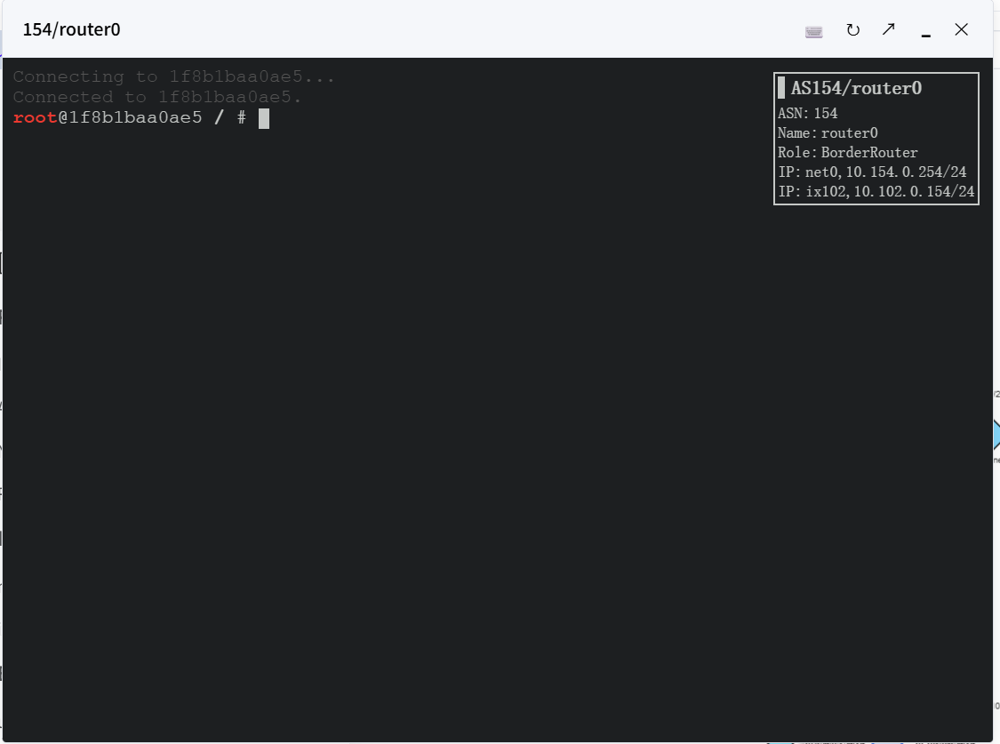

[User manual](../user-manual.md) / [Topology](README.md)

# Node actions and terminals

Click a node in a live map to inspect its identity and available runtime controls. Verify the name, ASN, role, and IP addresses before making a change.

## Open a terminal

1. Open **MAP** and click the intended host or router.
2. In **Actions**, select **Launch console** (called **Start Console** in some versions).
3. Use the terminal for the lab commands required by your experiment.
4. Close the terminal when finished.

Console access may be disabled by the administrator. An uploaded node represents saved data and has no live terminal.

## Change a network connection

Use **Disconnect** in the node's Actions section to interrupt its network connection. Use **Re-connect** to restore it. Click **Refresh** in the details to update runtime information.

This changes the running experiment and can interrupt traffic. Hiding or collapsing a node is a display operation; disconnecting it changes connectivity.

## Manage a BGP peer

1. Select a router or route server with configured peers.
2. Read the **BGP sessions** list and find the intended peer.
3. Choose **Disable** or **Enable** for that peer.
4. Refresh or reopen the details to check its reported state.

Changing a peer can change routing. Follow the experiment procedure and restore its intended state afterward. Hosts have no BGP peer controls, and a router may report no configured peers. If expected actions are missing, check that the node is live and ask your administrator about access.

[Back to Topology](README.md)
