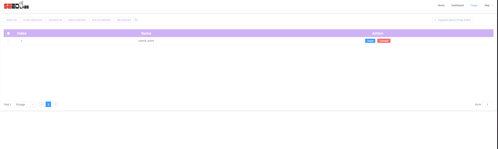

[User manual](../user-manual.md) / [Topology](README.md)

# Use experiment plugins

Choose **PLUGIN** on Home to open **/pro/plugin**. Plugins add tools to running emulator containers. The documented plugin is **submit_event**, which lets an experiment request visual changes such as highlighting or flashing nodes on the map.

## Install or remove a plugin

1. Confirm with the experiment procedure that the plugin is needed and the nodes are running.
2. Find **submit_event** in the list.
3. Click its row's **Install** action and wait for the operation to finish.
4. If an error appears, report it to the lab operator rather than repeatedly installing.
5. Use the row's **Uninstall** action when the experiment no longer needs it.

Installation changes the running containers. The toolbar's selection and bulk-action buttons are placeholders in the current page; use the plugin row's Install / Uninstall actions.

## Use submit_event in an experiment

After installation, the tool is available as **/map-plugins/submit_event.sh** inside the containers. If your lab exercise asks you to trigger a visual event, open that node's [terminal](node-actions.md) and run, for example:

    bash /map-plugins/submit_event.sh -a flashOnce

Return to the live map to observe the node. Supported actions include **flashOnce** (one flash), **flash** (repeated flashing), and **highlight** (highlight the node). An exercise can also supply a style file through **-s** / **--style**; use the file provided for that exercise.

A visual event changes the map's appearance. It does not prove that packets traversed a link. Use [traffic capture](traffic-replay.md) when you need packet evidence.

If the script is missing, verify that installation completed for the running experiment and that you opened the intended container. Uploaded topology files do not contain live containers in which to install plugins.

[Back to Topology](README.md)
