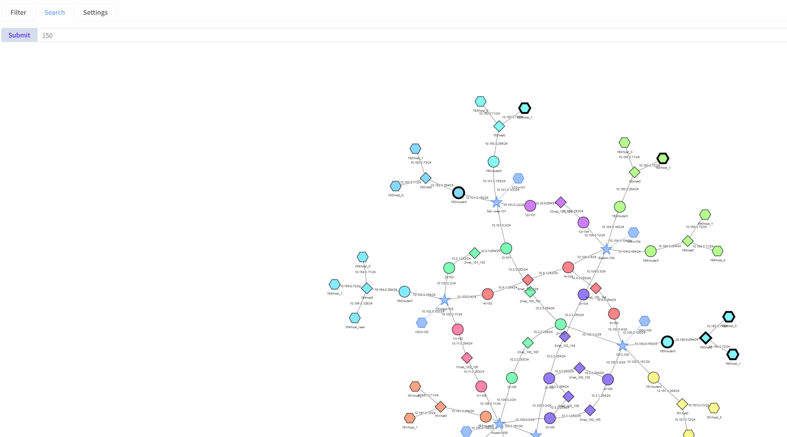
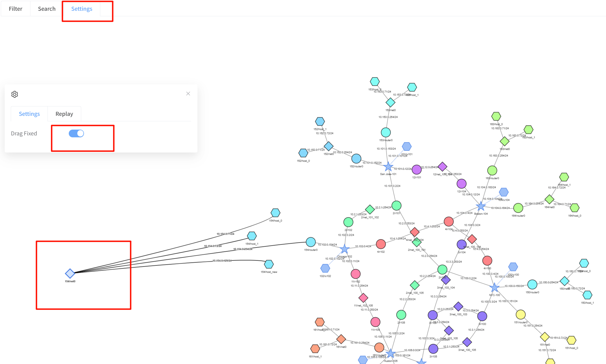
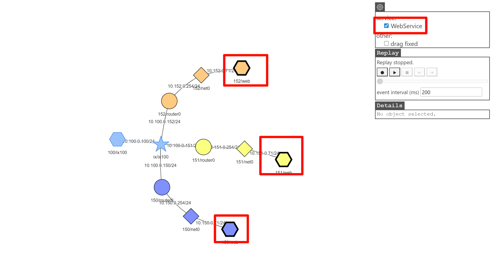

[User manual](../user-manual.md) / [Topology](README.md)

# Search and display settings

Use search to find a node or network, and Settings to make a crowded diagram easier to read. Search is distinct from packet filtering: it highlights topology objects without starting a capture.

## Search by name or address

1. Open **Search** on the map page.
2. Enter a node or network name, label, or IP address from your experiment.
3. Press **Enter** or click **Submit**.
4. Inspect the highlighted matches and click one to open its details.

If there are no matches, check the value and the groups currently displayed. On IX or Transit views, a more detailed node may not be visible until expanded; use the full MAP view when necessary.

## Keep dragged positions

1. Open **Settings**.
2. Turn **Drag Fixed** on.
3. Drag a node to the desired position.
4. Turn Drag Fixed off when you want the automatic layout to adjust positions again.

## Highlight services

If the experiment contains recognized services, a service selector appears in Settings. Select a service such as **WebService** to highlight the borders of nodes providing it. Clear the selection to restore their normal appearance. The same service uses a consistent color within the displayed view, but the chosen color can vary.

Service highlighting and Drag Fixed affect the display; they do not install services or change the network. For packet activity, use [Capture and replay](traffic-replay.md).

[Back to Topology](README.md)
