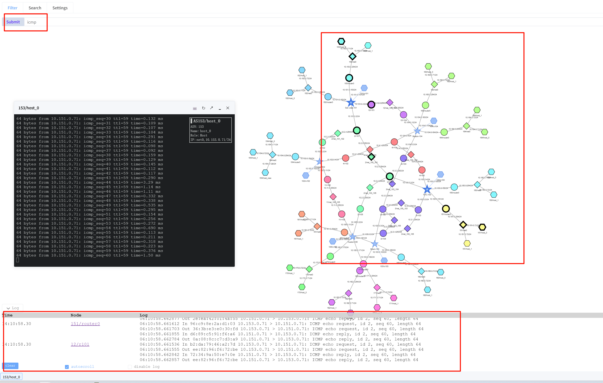
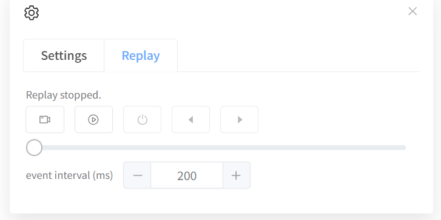
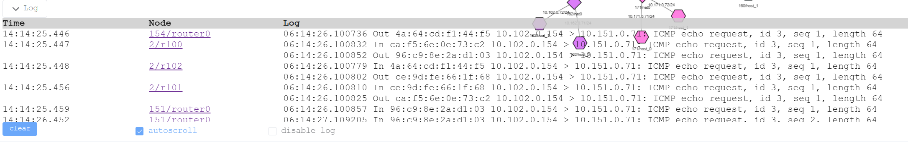

[User manual](../user-manual.md) / [Topology](README.md)

# Capture, replay, and packet log

Use the live map's **Filter** tab to observe selected packets, **Replay** to review recorded events, and **Log** to read packet information. These tasks require a running experiment with capture available. They do not work on uploaded topologies.

## Start a capture

1. Wait for the live topology to finish loading.
2. Open **Filter** and enter a capture expression such as **icmp**.
3. Press **Enter** or click **Submit**.
4. Observe the nodes that flash when matching packets arrive.
5. Open **Log** to inspect their packet information.

Use a filter appropriate to your experiment, such as **tcp** or **host 10.150.0.71**. Replace example addresses with real experiment addresses. A filter selects traffic; it does not generate it. To end a capture, submit an empty filter.

## Record and replay

Open **Settings ? Replay** to access the replay controls.

1. Start a capture that matches real traffic.
2. Click the **record (dot)** control to begin recording incoming events.
3. Stop recording when you have the events you need.
4. Use **play / pause (triangle)** to review the recording.
5. Use the step arrows to move backward or forward and **stop (square)** to stop playback.
6. Adjust **Event interval** to change the delay between replayed events.

Recording begins when you enable it; earlier live activity is not automatically included. Keep the page open while reviewing the recording. These controls are different from Geographic's offline JSON / PCAP import.

## Read the packet log

Expand **Log** to read matching packet records. Collapse it when you need more space for the diagram. If **disable log** is selected, turn it off to resume log output; use the autoscroll option when following new entries.

## If there is no activity

Check that you are on a live page, that the expression is valid, and that the experiment is producing matching traffic. An empty replay may mean recording was not enabled. If the map responds but no packets arrive with a known valid filter, ask the lab operator to check capture availability.

[Back to Topology](README.md)
