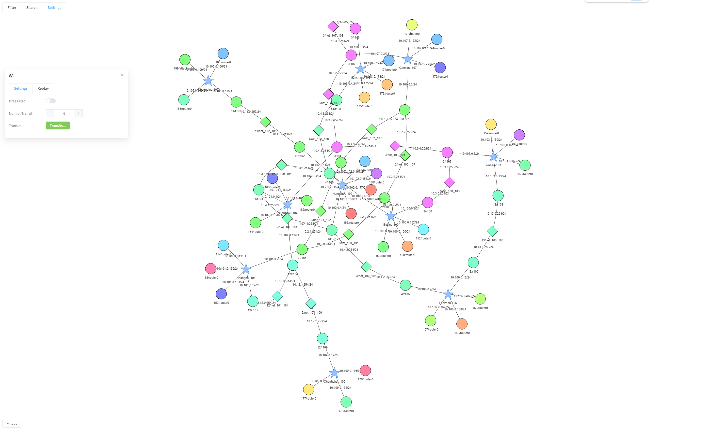
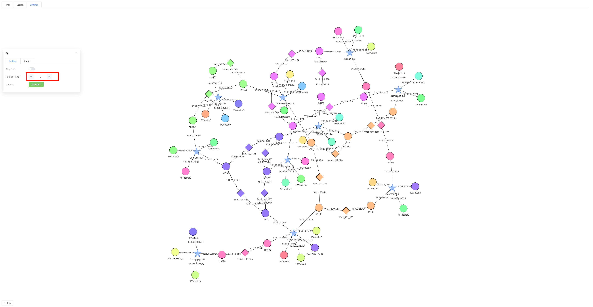
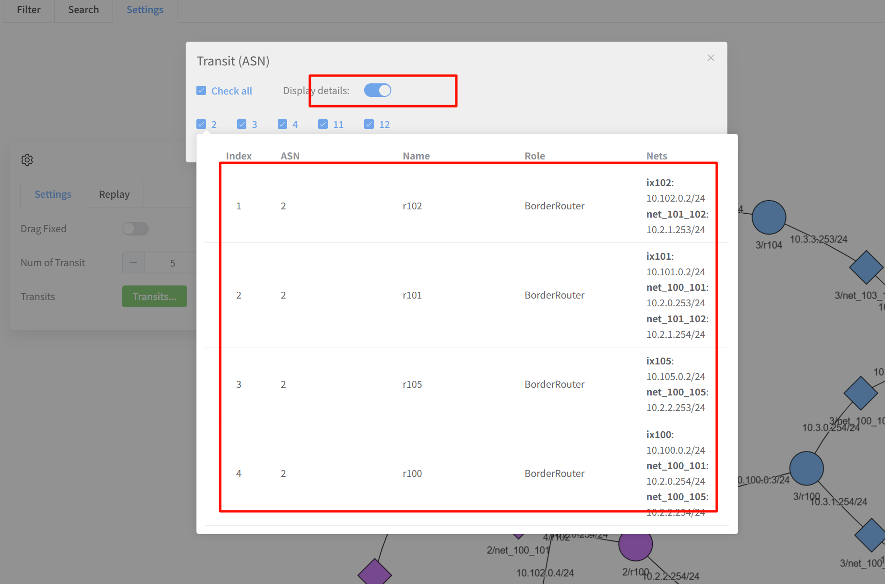

[User manual](../user-manual.md) / [Topology](README.md)

# Explore the transit view

Choose **TRANSIT MAP** on Home to open **/pro/transitMap**. This view starts at the transit level and omits deeper host detail initially. It is useful when comparing the networks connecting exchanges.

## Choose the initial scope

If prompted to display all nodes, choose **Yes** for the full initial view or **No** to select groups through **Settings ? Categories**.

## Limit the number of transit networks

1. Open **Settings** and change **Num of Transit**.
2. Click outside the number field.
3. Wait for the diagram to redraw.

More highly connected transit groups take priority. A count limit does not select a particular ASN; use the name selector for that.

## Choose by ASN

1. Click the **Transits...** / **Transit** selection button in Settings.
2. Select the ASNs you want to inspect.
3. Enable **Display details** if you want details while hovering over an ASN.
4. Click **Confirm** and wait for the diagram to update.
5. Reopen the selector to change or broaden the selection.

Filtering the diagram does not disable unselected transit networks. To inspect deeper nodes, expand them or switch to [MAP](network-map.md). Use [Search](search-display.md) when you know an endpoint's name or address.

[Back to Topology](README.md)
