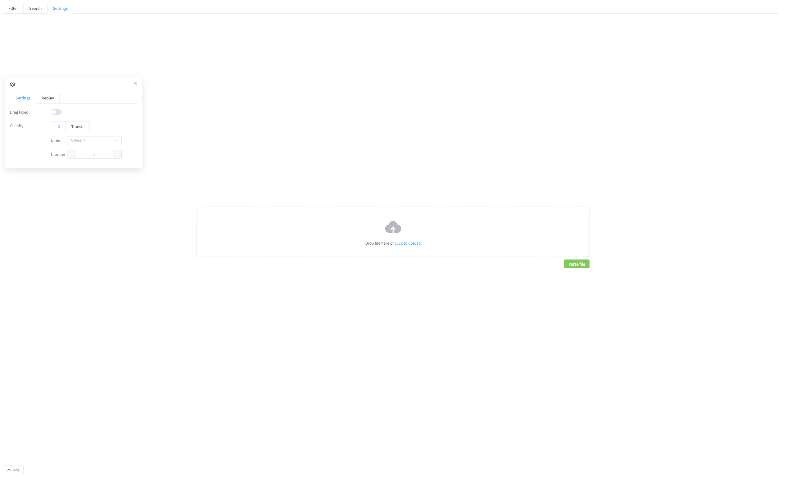

[User manual](../user-manual.md) / [Topology](README.md)

# Upload a saved topology

Choose **Upload MAP** on Home to open **/pro/uploadMap**. Use this page to explore a saved experiment without running its containers.

## Load the experiment

1. Obtain the emulator-generated **docker-compose.yml** from the experiment owner.
2. Drag it onto the upload area, or choose it using the file picker.
3. Click **Parse file** and wait for rendering to complete.
4. Open **Settings ? Categories** and choose **IX** or **Transit**.
5. Set the desired names or number of groups, then inspect the diagram.

## Available tasks

You can inspect the network structure, search for nodes, adjust the layout, and choose the IX or transit groups to display. Use [Search and settings](search-display.md), [IX selection](ix-view.md), and [Transit selection](transit-view.md) for the corresponding controls.

An uploaded file does not start an experiment. **Filter**, live terminal access, and actions requiring running nodes are unavailable. This Topology upload page does not provide the Geographic JSON / PCAP replay workflow; use the shared [Geographic traffic replay guide](../geographic-3d/traffic-replay.md) for both 2D and 3D views.

## If nothing appears

Check that parsing finished, that you selected display categories, and that the file is an emulator export rather than a general Compose file. Ask the experiment owner for a complete export if parsing reports an error.

[Back to Topology](README.md)
